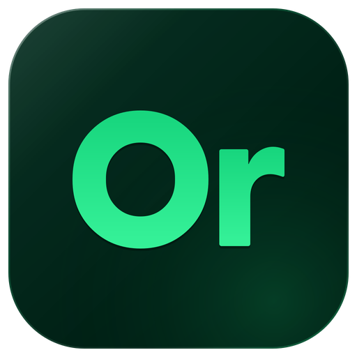
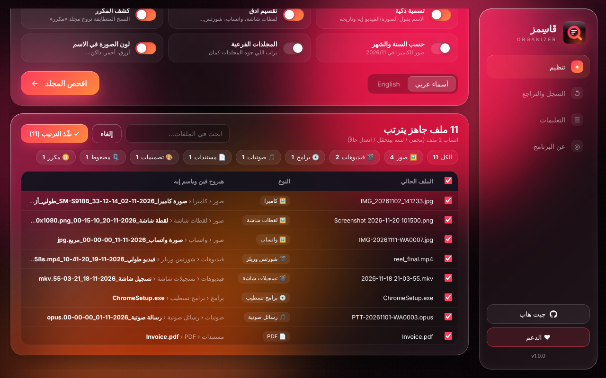
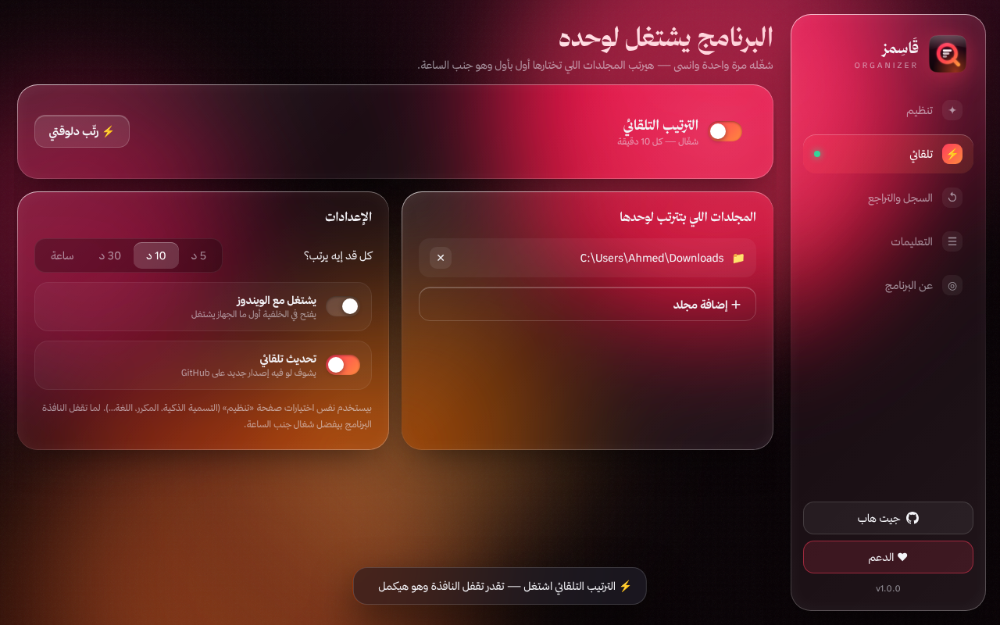

<div align="center">



# QASSIMZ Organizer

**رتّب ملفاتك في ثانية — صور، فيديوهات، برامج، مستندات… كل حاجة في مكانها وباسم مفهوم.**

من **أحمد قاسم — قَاسِمز** · مجاني ومفتوح المصدر · Windows 10/11

[⬇️ تحميل آخر إصدار](https://github.com/ahmedqassimtv-commits/qassimz-organizer/releases/latest) ·
[🐞 الدعم والإبلاغ عن مشكلة](https://github.com/ahmedqassimtv-commits/qassimz-organizer/issues) ·
[🌐 qassimz.com](https://qassimz.com)



</div>

---

## ✨ بيعمل إيه

| | |
|---|---|
| ⚡ **بيشتغل لوحده** | فعّل «الترتيب التلقائي» وهو يرتب التنزيلات (أو أي مجلد) كل 5 / 10 / 30 / 60 دقيقة من جنب الساعة |
| 🔁 **يشتغل مع الويندوز** | بيفتح في الخلفية أول ما الجهاز يشتغل |
| ⬆️ **تحديث تلقائي** | بيشوف آخر إصدار على GitHub ويحدّث نفسه بضغطة (من غير صلاحيات أدمن) |
| 🗂️ **ترتيب حسب النوع** | صور، فيديوهات، صوتيات، مستندات، برامج، مضغوط، أكواد، خطوط، تصميمات (PSD / AI / AEP / MOGRT)… |
| 🧠 **بيعرف الصورة/الفيديو إيه** | كاميرا 📸 · لقطة شاشة 🖥️ · واتساب 💬 · جرافيك 🎨 · خلفيات 🌄 · شورتس وريلز 📱 · تسجيل شاشة 🎬 · رسائل صوتية 🎙️ |
| ✍️ **تسمية ذكية** | `صورة كاميرا_2026-11-02_14-12-33_SM-S918B_طولي_أزرق.jpg` · `فيديو طولي_2026-11-19_1080p_58s.mp4` |
| ♊ **كشف المكرر** | النسخ المتطابقة 100% تتنقل لمجلد «مكرر» — مفيش مسح |
| 👀 **معاينة قبل التنفيذ** | تشوف كل ملف هيروح فين، وتشيل اللي مش عايزه |
| ↺ **تراجع** | ترجّع آخر ترتيب بضغطة |
| 🖱️ **كليك يمين** | على أي مجلد ← «رتّب بـ QASSIMZ Organizer» |
| 🌐 **عربي أو English** | أسماء المجلدات والملفات باللغة اللي تختارها |
| 🔒 **خصوصية** | كل الشغل على جهازك. مفيش أي ملف بيترفع |

## 🚀 التسطيب

1. نزّل `QASSIMZ-Organizer-Setup-x.x.x.exe` من [Releases](https://github.com/ahmedqassimtv-commits/qassimz-organizer/releases/latest).
2. شغّله وكمّل خطوات التسطيب (فيه نسخة Portable كمان لو مش عايز تسطيب).
3. لو ظهرت شاشة SmartScreen الزرقا: **More info ← Run anyway** (البرنامج مش موقّع بشهادة مدفوعة).

## 📖 طريقة الاستخدام

1. **اختار المجلد** — التنزيلات أو سطح المكتب أو أي مجلد.
2. **ظبط الاختيارات** — تسمية ذكية، تقسيم أدق، كشف المكرر، حسب السنة والشهر، المجلدات الفرعية.
3. **افحص** وشوف المعاينة.
4. **نفّذ الترتيب**.
5. مش عاجبك؟ **السجل والتراجع ← تراجع عن آخر ترتيب**.

### ⚡ خليه يشتغل لوحده
1. افتح صفحة **تلقائي** وشغّل **الترتيب التلقائي**.
2. اختار المجلدات (التنزيلات متضافة جاهزة) وكل قد إيه يرتب.
3. شغّل **يشتغل مع الويندوز**.
4. اقفل النافذة — البرنامج هيفضل جنب الساعة 🕘 (كليك يمين على الأيقونة: رتّب دلوقتي / إيقاف / خروج).



> البرنامج **مش بيمسح أي ملف**. والملفات اللي لسه بتتحمّل (`.crdownload` / `.part`) أو اتعدلت من أقل من دقيقتين مش بتتلمس.

### البرنامج بيعرف نوع الصورة إزاي؟
- **كاميرا:** بيانات EXIF (اسم الموبايل/الكاميرا وتاريخ التصوير).
- **لقطة شاشة:** الاسم، أو PNG بمقاس شاشة معروف.
- **واتساب:** صيغة الأسماء `IMG-YYYYMMDD-WAxxxx`.
- **جرافيك:** PNG/WebP شفاف أو صغير (لوجوهات، ملصقات).
- **خلفيات:** مقاسات 2K / 4K / 5K / Ultrawide.
- **فيديو طولي:** الارتفاع أكبر من العرض (بيقرا بيانات MP4/MOV من غير ffmpeg).
- **اللون:** اللون الغالب في الصورة بيتضاف للاسم.

## 🛠️ للمطورين

```bash
pip install -r requirements.txt
python app/main.py          # تشغيل
build.bat                   # يبني البرنامج + الـ installer (محتاج Inno Setup 6)
```

### نشر إصدار جديد (والبرنامج عند الناس يحدّث نفسه)
1. غيّر `VERSION` في `app/main.py` (مثلاً `1.1.0`).
2. اعمل push على `main`.
3. GitHub Actions هيبني الـ Setup والنسخة Portable وينزّلهم في Releases، وكل اللي مسطّب البرنامج هيظهرله «تحديث جديد».

```
app/core.py          محرك التصنيف والتسمية والتراجع
app/main.py          نافذة البرنامج (pywebview)
app/ui/              الواجهة (Liquid Glass — HTML/CSS/JS)
assets/              اللوجو (SVG / PNG / ICO)
installer/setup.iss  سكريبت الـ installer
```

## ❤️ الدعم

- مشكلة أو اقتراح؟ [افتح Issue](https://github.com/ahmedqassimtv-commits/qassimz-organizer/issues).
- عجبك البرنامج؟ اديله ⭐ على GitHub وشاركه.

---
<div align="center">© 2026 أحمد قاسم — قَاسِمز · MIT License</div>

<!-- QASSIMZ-LIQUID-GLASS-RELEASE -->
---

## ✨ الجديد في الإصدار `v1.4.0` — تصميم Apple Liquid Glass & أيقونات v2


- أيقونة جديدة `Or` (**v2 · Adobe 2022 Style**) بلون زمردي مشرق (`#18D67E`).
- تحسين طبقات **Apple Liquid Glass** وتوحيد الألوان الزمردية وشاشات المثبّت المتحركة.

<!-- /QASSIMZ-LIQUID-GLASS-RELEASE -->
